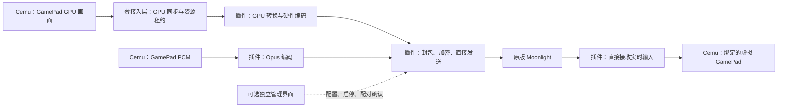

# Cemu 远程 GamePad：Moonlight 插件化实施规划

状态：设计规划，尚未实现或联调。日期：2026-10-27。
设计约束：媒体链路直接发送，首版即采用 GPU 驻留画面接入；禁止额外媒体中转和整帧等待。
源码检查基线：Cemu main，提交 42876aa86d2b92f9c620a76959a792bf392b89d3。

## 1. 目标与范围

通过原版 Moonlight 客户端，把远端设备变成 Cemu 的远程 GamePad：

- 向客户端发送 GamePad（DRC）的画面和独立音频。
- 把客户端按钮、摇杆和触摸输入送入 Cemu 的虚拟 GamePad。
- 对支持相应事件的客户端接入陀螺仪、加速度和震动反馈。
- 保持 TV 画面的本地使用方式；GamePad 推流不依赖本地 GamePad 窗口打开。
- 推流逻辑独立发布，尽量降低跟随 Cemu 升级的维护量。
- 视频、音频和实时输入在进程内插件与 Moonlight 之间直接传输，独立管理进程不进入逐帧/逐包路径。
- “不增加转发延迟”落实为取消媒体中转、CPU 画面读回与额外整帧排队；GPU 同步、GPU 内必要的转换、编码和网络仍有物理耗时，不能宣称端到端为零。

规划首发环境采用 Windows x64 + Vulkan；这是基于当前工作环境的实施默认值，其他系统与图形后端另行适配。首版支持一个远端客户端控制指定的一个 GamePad。

“音频”在本规划中指 GamePad 输出音频；麦克风上行不计入首版。触摸与体感属于完整 GamePad 接入目标，不能以只有按钮的中间版本宣称整体完成。客户端没有对应能力时应明确显示支持情况。

## 2. 已确认事实与升级边界

### 2.1 Cemu 侧

在本次检查的加载路径、输入工厂和构建结构中，没有发现可直接承载此功能的通用原生插件接口。现有 DLL 加载主要用于系统和设备依赖；输入后端通过枚举、工厂及源码注册。

因此，本项目当前可承诺的是“插件独立升级、Cemu 接入层集中适配”，不能承诺“任意官方 Cemu 二进制直接替换后仍能加载本插件”。

升级模式：

| 变化 | 预期维护范围 |
| --- | --- |
| 插件修复、码率设置、网络协议更新 | 只更新插件或管理组件；接口版本兼容时不重编 Cemu |
| Cemu 更新且接入代码仍兼容 | 重放小补丁，重编并验证接入版 Cemu |
| Cemu 渲染、音频或输入结构变化 | 适配接入层，插件接口尽量保持不变 |
| 用户直接安装官方未带接入层的 Cemu | 该版本照常使用，但不能把它当成支持此插件的版本 |
| 接入接口未来被上游接受 | 在上游支持的版本范围内，争取直接安装插件 |

### 2.2 Moonlight / Sunshine 侧

Moonlight-common-c 是客户端核心库，不提供可直接嵌入 Cemu 的主机 SDK。Sunshine 已有主机端配对、会话、音视频传输和输入处理，可作为协议及编码实现的参考与复用基础。

Sunshine 的采集和编码接口是其内部 C++ 接口。本项目需把需要的功能组织成可供插件链接的主机核心，维护固定上游提交与明确的适配分支；不能把原版 Sunshine 当成现成可嵌入 SDK，也不能把独立 Sunshine 进程放在媒体中转路径上。主机核心的可拆分性是 P0 必须先解决的问题。

## 3. 推荐架构

采用“薄接入层 + 进程内推流 DLL + 可选独立管理界面”。插件独立发布、独立构建，但媒体处理与 Cemu 位于同一进程。

### A. Cemu 接入层

负责插件加载、DRC GPU 画面资源接入、DRC PCM 提交、输入快照读取以及启动和停止通知。

只有这一层依赖 Cemu 的类和内部头文件。源纹理的生命周期和图形同步留在这一层；插件只获取标准图形 API 资源描述与显式租约，不读取 Cemu 类布局或私有对象。

### B. 进程内推流插件

独立 CMake 项目，通过版本化 C ABI 与接入层通信。插件持有编码器、Moonlight 主机会话和网络 socket，直接编码和发送；输入也直接从远端到插件，再交给 Cemu。

渲染线程只提交必要的 GPU 工作和描述符。编码完成、封包与发送在插件工作线程进行，以 GPU/驱动完成事件驱动，不定时攒帧，也不等 Cemu 下一次界面循环转发。

主机核心与编码依赖只进入插件，Cemu 主程序只链接接入接口。首版在启动时加载、退出时卸载 DLL，运行中可以开始或停止会话。

这一取舍优先满足低延迟与无中转要求。编码器和协议代码位于 Cemu 进程内，插件崩溃可能影响 Cemu，不能沿用“独立服务崩溃完全隔离”的承诺。

### C. 可选独立管理界面

只负责配置、版本管理、状态显示和配对确认；媒体、实时输入与震动包均不经过此进程。

插件处理 Moonlight 主机协议和配对状态。管理界面退出后，已建立的会话不依赖它继续转发；新连接需要确认时由插件按明确授权状态处理。

对外只提供“Cemu GamePad”应用入口，不采集桌面、不依赖虚拟显示器，不提供任意程序启动功能。

## 4. 方案取舍

| 方案 | 特点 | 决定 |
| --- | --- | --- |
| 薄接入层 + 进程内推流插件 | GPU 资源直接接入编码，插件直发；升级适配集中在接入层 | 推荐并作为首版约束 |
| CPU 画面读回 + 共享内存 + 独立推流进程 | 增加读回、跨进程传递与调度环节 | 不采用 |
| GPU 共享纹理 + 独立媒体进程 | 可避免 CPU 读回，但仍有跨进程同步和维护成本 | 不作为首版媒体路径 |
| 把全部 Sunshine 编入 Cemu 主程序 | 直接发送，但主程序依赖和升级耦合较大 | 不采用 |
| DLL 注入、特征码搜索、内部函数挂钩 | 二进制变化容易破坏兼容性 | 不作为主路线 |
| 桌面/窗口采集 + 系统音频与虚拟手柄 | 无法直接满足独立 DRC 音画和关闭窗口采集的目标 | 不采用 |

## 5. Cemu 接入位置与修改边界

位置基于上述基线；升级时按符号和语义定位，不依赖固定行号或机器码地址。

| 模块 | 接入位置 | 必须处理的细节 |
| --- | --- | --- |
| 普通游戏 DRC 画面 | src/Cafe/HW/Latte/Core/LatteRenderTarget.cpp：LatteRenderTarget_itHLECopyColorBufferToScanBuffer | 按 RENDER_TARGET_DRC 识别真实来源，放在 IsPadWindowActive 判断之前 |
| OSScreen DRC 画面 | src/Cafe/HW/Latte/Core/LatteThread.cpp：LatteHandleOSScreen_DRC | 覆盖另一条 DRC 输出路径，避免只支持 GX2 游戏画面 |
| Vulkan GPU 接入 | src/Cafe/HW/Latte/Renderer/Vulkan/ 下新增适配文件 | 在 GPU 上生成编码器兼容资源；定义 layout、mip/slice、队列、完成信号和归还时机 |
| DRC 音频 | src/Cafe/OS/libs/snd_core/ax_out.cpp：AIInitDRCDMA / AXOut_SubmitDRCFrame | 从可用的最小 DRC PCM 块接入；不等待现有四块一组的本地播放缓冲；不依赖 g_padAudio 非空 |
| 输入 | src/input/ 下新增远程 Controller / Provider 适配 | 通过现有手柄映射进入 VPAD；本地配置显式绑定远程来源 |
| 触摸与体感 | src/input/emulated/VPADController.cpp 及现有运动转换层 | 避开本地窗口尺寸依赖；明确坐标、单位及输入来源优先级 |
| 生命周期 | 游戏启动/停止、Renderer 初始化/销毁、输入管理器关闭处 | 在 GPU 和手柄对象释放前停止使用相关资源 |
| 构建 | 相关 CMakeLists.txt | 增加可关闭的接入构建选项；不把编码库加入 Cemu 常规依赖 |

画面采集前必须执行与本地呈现相同的纹理更新和在用标记，不能只增加一个回调就假定内容已就绪。

不能根据“当前显示在主窗口还是副窗口”推断 DRC 来源，因为 Cemu 允许交换显示内容。首次实现需要确定远端画面中软键盘和游戏交互叠层的呈现方式；若要完整远程操作，不能只传底层纹理而漏掉必要的交互界面。

## 6. 独立接口设计

接口名称暂定 GamePad Extension API v1，仅为本项目规划的接口，并非 Cemu 现有官方 API。

- 使用 C 函数表、固定宽度字段、明确调用约定和结构大小；主/次版本和能力位用于协商，不匹配时拒绝推流并显示原因。
- 不跨 DLL 边界传 STL、C++ 异常、Cemu 类或隐式所有权。
- v1 即定义 GPU 资源接入：同一物理显卡标识、设备上下文、资源句柄/描述符、格式、尺寸、色彩信息、子资源范围、同步原语、帧序号和时间戳。
- 若编码器通过另一图形/计算 API 使用资源，必须明确该后端的导入、同步与释放协议；不能把原始 VkImage 数值当成另一 API 可直接使用的资源。
- GPU 资源由拥有方管理，明确 acquire、ready 和 release 的生命周期；编码完成前不得复用对应资源。
- GPU 命令的提交权限与线程约定必须清楚。插件不能绕过 Cemu 的队列同步，或从任意工作线程使用 Cemu 命令池。
- 画面、音频、输入使用同一单调时钟和会话代号；游戏停止、格式变化或设备重建后旧代号作废。
- PCM 块和输入状态直接经进程内接口传递；音频回调返回前需完成必要的小块复制，不能保留短期源指针。
- 可选管理通道另行版本化，仅传配置与状态；不承载媒体或实时输入。

输入快照包含按钮、两根摇杆、扳机、触点、运动数据、时间戳和连接状态。震动直接通过插件会话发送。失联或状态过期时释放所有按钮与触点。

GPU 兼容资源池是维持所有权和硬件并行的手段，不是按槽位数量引入固定帧延迟。资源数量遵循编码器实际要求；排队策略独立限制为优先处理最新未编码帧。

## 7. 三条数据路径

### 7.1 画面

首版媒体路径：

**DRC GPU 纹理 → GPU 内必要的合成/缩放/颜色转换 → 同显卡硬件编码器 → 插件封包并直接发送 → Moonlight。**

1. 在两条 DRC 输出入口识别实际 GamePad 帧，更新纹理并标记资源在用。
2. 优先复用编码器可导入的 GPU 资源；源格式或生命周期不匹配时，在 GPU 内写入预注册的编码输入资源。
3. GPU 队列间通过经验证的同步机制衔接。避免为了交接而调用 vkDeviceWaitIdle、逐帧 CPU 等待 GPU 或延后到下一帧检查完成。
4. 编码器在资源就绪后开始处理；插件工作线程按实际后端能力接收完成事件，立即处理可用编码输出，不等下一帧触发发送。
5. 协议封包、加密、FEC 和必要的发送节奏由插件直接完成；不送往本地媒体服务、回环网络或第二个发送进程。

首版以约 854×480、最高 60 fps 为默认目标；采集服从实际纹理尺寸，客户端协商的缩放与颜色转换在 GPU 完成。连接时预注册可复用输入资源，避免逐帧创建/销毁编码会话和资源。

不采用未压缩画面的 GPU → CPU → GPU 往返。编码后压缩码流进入主机内存交给网络栈仍可能是后端的正常步骤，与整幅原始画面读回区别记录。GPU 内必要的拷贝、转换和同步均需计时，不能统称为零开销。

在同一物理显卡上完成渲染与编码。NVIDIA、AMD 和 Intel 分别验证其资源互操作方式；首发只声明已验证的具体后端、显卡与驱动组合，其他组合明确拒绝启动，不静默改为 CPU 读回、软件编码或跨显卡拷贝。

低延迟编码配置：

- 首版关闭需要未来帧的 lookahead 和帧重排序；从无 B 帧的配置起步。
- 按实际编码器选择低延迟模式、受控码率与较小 VBV，核对最终生效参数，避免预设暗中打开缓存。
- 无未编码积压时立即提交；编码器繁忙时，只保留最新待提交画面，淘汰旧的未编码画面。
- 编码后的参考帧和网络分片不能按未编码帧策略任意丢弃；网络过载时调整码率/帧率，必要时按协议请求或发送恢复帧。
- 区分资源池大小、编码器在途帧数与待编码排队长度。不能为了保留三个资源槽而固定等三帧。
- 不添加额外的帧率转换定时器、固定一帧延后或应用层抖动缓冲。保持协议所需的重传/FEC与发送节奏，并记录其等待。

上述编码参数参考 [NVENC 官方低延迟设置](https://docs.nvidia.com/video-technologies/video-codec-sdk/13.1/nvenc-video-encoder-api-prog-guide/index.html)，属于本项目的保守首发配置，不意味着所有 B 帧模式都必然引入重排序。

CPU 截图/readback 路径仅可供理解现有同步规则，不作为首版实施路径。GPU 互操作不通就是必须解决的阻塞项，不能先以高延迟路径交付后再声称满足要求。

### 7.2 音频

- 从可用的最小 DRC PCM 块直接提交插件，使用实际样本数、声道布局和源采样率。
- 接入位置在现有四块一组的本地播放聚合之前，避免继承这层额外等待；同时保持本地播放逻辑不变。
- 转换为协商的 48 kHz 立体声 Opus 输入。按协议和客户端支持的帧长选择低延迟参数，不在编码帧长之外再攒一组数据。
- Opus 自身帧长、算法延迟、重采样及网络包处理耗时分别记录；不能称为零延迟。
- 编码和网络发送在插件工作线程完成；音频生产线程不等待网络。
- 不要求本地 GamePad 扬声器设备存在，不改变原有本地音频步长或设备配置。
- 停止会话时清理旧音频；重连使用新的会话代号，不能播放上一会话的积压样本。
- 独立配置本地 GamePad 是否同时发声；TV 音频不进入远程流。

### 7.3 输入

- 插件直接接收 Moonlight 实时输入，网络线程更新带时间戳的状态；Cemu 在自己的输入路径读取最新快照，不经管理进程转发。
- 不为输入设置固定周期的中转队列；保留必须按序消费的按钮边沿和触摸状态转换，不能只合并最后状态而漏掉短按。
- 在 Cemu 手柄配置中提供可识别的远程 GamePad 来源；连接本身不覆盖用户已有映射。
- 默认由用户选定远程控制的 GamePad 槽位；该槽位的控制来源要明确，避免本地和远端状态相互覆盖。
- 按钮采用 Wii U 标签语义映射，检查 ABXY 布局、摇杆方向和扳机阈值。
- 将绝对触摸坐标转换到远端视频的有效 GamePad 区域，再转换为 VPAD 坐标；处理黑边、旋转、按下、移动、抬起和取消。
- 协议层支持触摸和运动事件不等于每个 Moonlight 客户端都会发送；按实际能力展示支持情况。
- 对客户端明确提供的绝对指针与按钮事件，可配置为 GamePad 触摸映射；相对鼠标模式不能冒充绝对触摸。
- Moonlight 运动接口标明陀螺仪为 deg/s、加速度为 m/s²。对接 Cemu 的运动融合前必须核对其输入约定，转换轴向、单位与时间间隔。
- 断线、超时、暂停控制、游戏结束和推流会话失败都释放输入。不能只依赖最后一条“抬起”消息到达。
- 不注入系统键鼠或系统虚拟手柄；输入只进入绑定的 Cemu GamePad。

## 8. 配置、失败处理和资源生命周期

- 功能默认关闭，用户显式启用后由已加载插件建立推流会话；独立管理界面可选，不参与音画和输入转发。
- 配置与配对数据放在独立用户数据目录，避免被 Cemu 安装包覆盖。
- 目录建议为 %LOCALAPPDATA%/CemuRemoteGamePad/，独立保存 versions、config、pairing 和 logs。
- 可选管理通信使用当前用户权限的命名管道，限制消息大小；媒体和实时输入不通过该通道。
- 首版以局域网使用为目标；沿用主机端配对授权机制，端口可配置，检测与现有 Sunshine 的冲突。
- 不修改 Cemu 自动更新配置或用户游戏、存档及现有输入配置。
- 不支持的渲染后端、编码器、接口版本和不匹配的组件组合均给出明确原因。
- 可处理的编码、网络或会话错误：停止会话并释放输入，让 Cemu 继续本地运行。进程内 DLL 的不可恢复崩溃无法保证隔离；管理界面退出不终止已授权的现有会话。
- 正常停止：禁止新提交 → 停止会话并释放输入 → 排空/取消工作 → 等待在途 GPU 使用安全结束 → 归还槽位和句柄。
- 游戏切换、停止和设备重建都执行同样的代号隔离，不能使用上一局的纹理或音频。
- v1 不在运行中卸载 DLL，减少回调与代码生命周期冲突。

## 9. 仓库与升级维护

当前仓库保持 origin 指向官方 Cemu。本阶段只新增本规划文档；以下为后续建议结构，尚未创建实现：

| 路径 | 用途 |
| --- | --- |
| docs/gamepad-moonlight-plan.zh-CN.md | 本规划 |
| extensions/gamepad/sdk/ | 稳定 C ABI、GPU 资源租约和管理通信协议定义 |
| extensions/gamepad/adapter/ | 仅这一部分依赖 Cemu 内部结构 |
| extensions/gamepad/plugin/ | 独立编译的进程内推流 DLL |
| extensions/gamepad/host-core/ | 插件可链接的协议、编码主机核心及受控上游引用 |
| extensions/gamepad/manager/ | 可选独立配置与管理界面，不处理媒体 |
| extensions/gamepad/compat/ | 已验证的组件组合、上游提交及兼容说明 |
| extensions/gamepad/packaging/ | 安装布局、独立构建和发布材料 |

插件工程不能包含 Cemu 内部头文件，也不能因为包含整棵 Cemu 构建树而失去独立构建能力。主机核心固定上游提交，不随每次构建追踪浮动 master；发布时保留上游许可证与来源信息。

Cemu 接入改动维护为一组可单独审查的提交：加载与生命周期、DRC 画面、DRC 音频、输入和构建。避免混入重构、格式整理或无关依赖更新。

每次升级流程：

1. 获取新的官方提交，在独立目录准备接入版；保留用户当前可用版本。
2. 重放接入提交，检查是否有冲突或入口语义变化。
3. 在用户授权的验证环节完成升级检查矩阵；不能只凭补丁无冲突认定兼容。
4. 发布包含 Cemu 提交、接入 API 版本、插件版本、主机核心和 GPU 后端版本的兼容组合。
5. 用户切换到新版本；失败可切回旧组合，配对数据和配置按版本迁移策略处理。

不承诺官方更新器覆盖接入版后功能仍在。首发采用并列安装的接入版发布方式；未来争取把小而通用的接入接口提交上游，以进一步降低维护量。

## 10. 实施顺序与交付条件

| 阶段 | 工作 | 完成条件 |
| --- | --- | --- |
| P0：GPU 与直发路径可行性 | 选定首台显卡和编码后端，验证 GPU 资源互操作；明确 Sunshine 主机核心的拆分和插件直发方案 | 真实 DRC GPU 资源可进入硬件编码器；无原始画面 CPU 读回、无媒体进程中转；不满足则先解决阻塞 |
| P1：独立插件边界 | C ABI v1、GPU 资源租约、加载器、版本协商、生命周期、独立 DLL | 插件可独立构建；禁用时无推流资源；不匹配时明确拒绝连接 |
| P2：音画直发闭环 | 两条 DRC 画面路径、GPU 资源接入、最小 PCM 块、Moonlight 配对与直接发送 | 原版客户端收到真实 DRC 音画；关闭本地 GamePad 窗口仍可推流；管理进程不承载媒体 |
| P3：可游玩闭环 | 直接输入、按钮边沿、触摸、断线清理；有能力客户端的体感与震动 | 可操作真实游戏，无卡键或残留触摸；输入与反馈不经额外进程中转 |
| P4：延迟、升级与发布 | 延迟跟踪、性能测量、独立安装包、版本兼容表、升级演练 | 证明无应用额外整帧等待和媒体中转；公开 p50/p95/p99、负载和兼容组合；在另一个官方提交演练升级与回退 |
| P5：覆盖扩展 | 增加编码后端、显卡和客户端覆盖 | 每个新组合仍满足 GPU 驻留、直发和生命周期要求 |

P2 是中间里程碑，不能当作全部功能交付。完整首版由 P0–P4 的结果共同定义；GPU 资源接入与无媒体中转属于首版要求，不延后到 P5。

P0 必须优先解决的实际问题：

- 固定可用的 Sunshine 提交，明确其协议/编码路径如何作为进程内主机核心使用，避免插件再把码流交给另一个主机进程。
- 在实际渲染显卡上验证编码器资源导入、GPU 同步、归还时机与低延迟参数，不假定同进程就自动实现资源互操作。
- 验证关闭 GamePad 窗口后两条 DRC 路径均可采集，并确定必要交互叠层的 GPU 呈现。
- 明确首个 Moonlight 客户端的系统和版本，核实触摸、体感与实际音频协商能力。
- 确认源音频块的接入时点，避免把已有本地播放聚合等待带入远程流。

以上问题未解决时不扩展多个平台，也不以无功能骨架、CPU 读回或媒体中转替代真实通路。

## 11. 未来验证矩阵

本规划阶段只做源码检查，不运行构建、测试或游戏。下列项目是实现阶段的验收要求，执行时遵循用户对验证的授权。

- 音画：DRC 与 TV 可区分、本地 GamePad 窗口关闭/重新打开、DRC-only 音频、本地音频设备关闭、游戏静音、OSScreen、分辨率/图形包变化。
- 输入：ABXY 与方向、摇杆/扳机、触摸黑边与抬起、已支持客户端的体感、震动、断线释放、重新连接。
- 生命周期：启动后未运行游戏、游戏停止/切换、客户端退出、编码器/会话错误、管理界面退出、设备重建、插件未安装/未启用/版本不匹配。
- 性能：同一场景对比禁用插件、启用未连接、连接推流的帧时间及 CPU/GPU 开销；分别记录 GPU 同步/转换、待编码排队、编码、封包与发送时间。
- 升级：新旧 Cemu 接入版、插件、主机核心和 GPU 后端的兼容/不兼容组合，配置迁移与旧版本回退。

“无额外转发延迟”的验收方式：

1. 跟踪 DRC 帧产出、GPU 输入就绪、编码提交/完成、首包/末包提交网络的时间点；CPU 和 GPU 时间域必须正确换算。
2. 同一显卡、同一编码参数、同一资源路径下，对比接入层加插件直发与等价的直接嵌入发送基线，判断插件边界的增量；不能拿“关闭推流”的版本直接推导网络发送延迟。
3. 报告 p50、p95、p99 和测量分辨率，覆盖空载、GPU 忙、编码器忙、网络拥塞和恢复过程。
4. 确认时间线上不存在由接口轮询、管理进程、固定定时器或额外媒体队列造成的一帧等待；原始画面不经过 CPU 读回。
5. 记录必要 GPU 拷贝、同步、编码器在途深度及协议发送节奏；这些真实成本不能隐藏在“零拷贝”或“零延迟”名称下。

架构目标是删除可避免的中转和等待，不承诺数学上的 0 ms 或固定“1 ms 以内”。实际接入增量、端到端延迟和帧率影响以测量为准；客户端解码和屏幕显示另行测量。

## 12. 参考依据

本地代码：

- [DRC scan buffer 与本地窗口判断](../src/Cafe/HW/Latte/Core/LatteRenderTarget.cpp)
- [OSScreen 的 DRC 输出](../src/Cafe/HW/Latte/Core/LatteThread.cpp)
- [Vulkan readback 同步示例](../src/Cafe/HW/Latte/Renderer/Vulkan/TextureReadbackVk.cpp)
- [DRC PCM 输出](../src/Cafe/OS/libs/snd_core/ax_out.cpp)
- [输入 Provider 工厂](../src/input/ControllerFactory.cpp)
- [VPAD 触摸与体感](../src/input/emulated/VPADController.cpp)
- [运动数据转换](../src/input/motion/MotionHandler.h)

上游资料（2026-10-27 检查）：

- [Moonlight 客户端核心库说明](https://github.com/moonlight-stream/moonlight-common-c/blob/master/README.md)
- [Moonlight 输入事件与能力协商](https://github.com/moonlight-stream/moonlight-common-c/blob/master/src/Limelight.h)
- [Sunshine 主机项目](https://github.com/LizardByte/Sunshine)
- [Sunshine 采集接口](https://github.com/LizardByte/Sunshine/blob/master/src/platform/common.h)
- [Sunshine 视频编码接口](https://github.com/LizardByte/Sunshine/blob/master/src/video.h)
- [NVENC 官方编码流程、GPU 资源与低延迟设置](https://docs.nvidia.com/video-technologies/video-codec-sdk/13.1/nvenc-video-encoder-api-prog-guide/index.html)
- [AMD AMF 官方编码接口](https://github.com/GPUOpen-LibrariesAndSDKs/AMF/blob/master/amf/doc/AMF_Video_Encode_API.md)

这些引用用于说明当前设计依据，不构成任意未来版本的兼容承诺。

